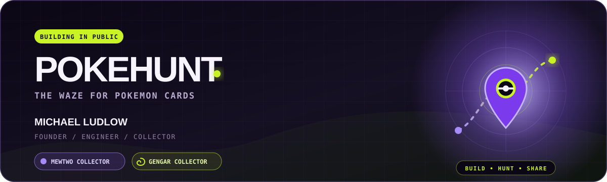

<p align="center">
  <a href="https://pokehunt.fun">
    
  </a>
</p>

<p align="center">
  <a href="https://pokehunt.fun/app"></a>
  <a href="https://discord.gg/3tD7pp2DAT"></a>
  <a href="https://pokehunt.fun/stock-checker"></a>
  <a href="https://pokehunt.fun/blog"></a>
</p>

<p align="center">
  <a href="https://pokehunt.fun"></a>
  
  
</p>

# Hey, I'm Mike 👋🏾

I'm the founder and lead builder of **[PokeHunt](https://pokehunt.fun)**—a community-powered platform helping Pokémon TCG collectors find cards at retail before the shelves are empty.

> We're building the **Waze for Pokémon cards**: real-time restock intelligence, verified community reports, local alerts, and rewards for collectors who help other collectors.

My day-to-day is a mix of **SwiftUI**, product engineering, retailer data, maps, community systems, and figuring out how to make hunting shiny cardboard suck less.

## 📍 PokeHunt Field Guide

- **[Launch the PokeHunt App](https://pokehunt.fun/app)** — live map, sightings, alerts, collection tools, and community features
- **[Check Pokémon Stock](https://pokehunt.fun/stock-checker)** — retailer and product intelligence without the scalper markup
- **[Join the Discord](https://discord.gg/3tD7pp2DAT)** — share finds, get drop intel, earn XP, and hunt with the community
- **[Read the TCG Intel](https://pokehunt.fun/blog)** — restock guides, product research, market watchlists, and release coverage
- **[Follow PokeHunt on X](https://x.com/pokehuntdotfun)** — shipping updates, restocks, giveaways, and collector chaos

## 🛠️ What I'm Building Right Now

```text
PokeHunt iOS     SwiftUI • MapKit • real-time alerts • field reporting
PokeHunt Web     React • TypeScript • maps • stock intelligence • community
Platform         Supabase • PostgreSQL • Cloudflare • automation • AI tooling
Community        Discord systems • XP • rewards • verified local intel
```

The product is built around one idea: **collectors working together can beat information hoarding.** One verified sighting helps every nearby hunter make a better decision.

## 🧬 Collector's Corner 👻

When I'm not shipping PokeHunt, I'm usually hunting **Mewtwo** and **Gengar** cards. Psychic menace on one side, purple chaos gremlin on the other. Perfect balance.

<p align="center">
  <a href="https://pokehunt.fun">
    
  </a>
  &nbsp;&nbsp;&nbsp;
  <a href="https://pokehunt.fun">
    
  </a>
</p>

<p align="center"><sub>Two of my favorite Pokémon to collect. If you've got a wild Mewtwo or Gengar pickup, come show it off in the <a href="https://discord.gg/3tD7pp2DAT">PokeHunt Discord</a>.</sub></p>

## ⚡ Builder Loadout

<p>
  
  
  
  
  <br>
  
  
  
  
</p>

## 📊 Engineering Activity

<p align="center">
  
</p>

<p align="center">
  
  
</p>

<p align="center">
  
</p>

<p align="center">
  <strong>Build the hunt. Share the find.</strong><br>
  <a href="https://pokehunt.fun">pokehunt.fun</a> • <a href="https://discord.gg/3tD7pp2DAT">Discord</a> • <a href="https://x.com/pokehuntdotfun">@pokehuntdotfun</a> • <a href="https://twitter.com/MikeeBuilds">@MikeeBuilds</a>
</p>
