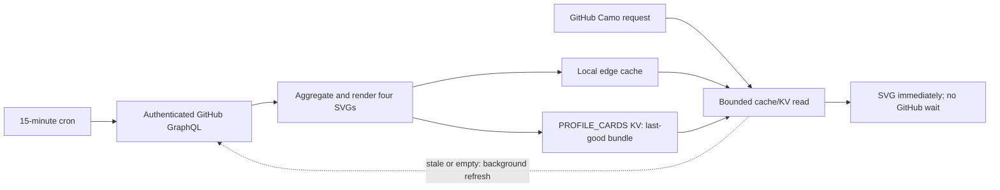

# Dynamic GitHub profile cards

The `mikeebuilds-github-stats` Cloudflare Worker serves SVG cards for MikeeBuilds:

- `/stats.svg` — current-year total/private/public contributions and repository totals.
- `/languages.svg` — language bytes aggregated across public and private owned repositories.
- `/streak.svg` — current-year contribution streaks from the authenticated calendar.
- `/activity.svg` — the latest 30 reported contribution days, including private activity.
- `/health` — static deployment health and version metadata, not a freshness check.

## Serving and refresh model

The old implementation performed paginated GitHub GraphQL requests on a cold
image request. GitHub's Camo image proxy could time out before that finished.
The third-party Vercel activity graph was also disabled. All four cards now use
the owned Worker and the same pre-rendered last-good bundle:



- `PROFILE_CARDS` KV holds only the four rendered SVGs, schema, and generation
  timestamp under `profile-cards:v1`. It is deliberately not expired on errors.
- Memory and the Cache API accelerate reads. The edge copy is retained for seven
  days but becomes stale after 15 minutes; stale edge/memory data checks KV so it
  does not hide a newer scheduled refresh.
- Reads have a 1.5-second storage budget. A storage failure serves any available
  last-good bundle. A completely unseeded deployment returns a valid, clearly
  labeled “refreshing” SVG with a 60-second cache TTL rather than a broken image.
- Empty/stale reads can request a background refresh. Requests within the same
  isolate share one refresh and retry no more than once a minute. Separate PoPs
  can still refresh concurrently; the scheduled trigger is the primary refresher.
- GitHub collection has a 20-second total timeout across at most five repository
  pages. Only a complete successful collection replaces the bundle. Failure
  retains old data; every data card displays its generation timestamp.
- Normal SVGs use a five-minute client TTL and a 15-minute shared-cache TTL.
  Camo may retain images longer. Query parameters do not create new origin cache
  keys or add arbitrary GitHub requests.
- `HEAD` and `GET` use the same bundle; `HEAD` never returns a body.

## Credential boundary

`GITHUB_TOKEN` stays a Worker secret. Use read-only GitHub access to the account's
repository metadata and authenticated contribution calendar. Do not place it in
README URLs, KV, logs, or source control. Repository names, source code, raw API
responses, tokens, and upstream error messages are never stored in the public
card bundle. The cards intentionally disclose aggregate public/private counts
and language totals, matching the prior profile behavior.

## Deploy and seed

Deploy the Worker **before** merging the README endpoint change.

1. Install the locked deployment tooling with `npm ci` and run `npm test`.
2. Provision/select a namespace in the configured account with
   `npx wrangler kv namespace create PROFILE_CARDS`. Add its **real** nonsecret ID
   to `wrangler.jsonc` as `kv_namespaces: [{ binding: "PROFILE_CARDS", id: "..." }]`.
   The binding is intentionally absent until provisioning can be completed;
   **this branch is not deployment-ready without it**. Do not invent a namespace ID.
3. Preserve the existing `GITHUB_TOKEN` secret. Only if absent, provision it with
   `npx wrangler secret put GITHUB_TOKEN`; never pass its value in command arguments.
4. Run `npm run deploy`. This deploys the `*/15 * * * *` scheduled trigger and KV
   binding. Cron changes can take time to propagate.
5. Seed via a direct request to `/languages.svg`; an empty deployment may initially
   return the fast placeholder while `waitUntil` renders and persists all cards.
   Inspect the direct response again after the background refresh finishes. Do
   not point the README at an unseeded service or treat `/health` as proof of data.
6. Confirm each of `/stats.svg`, `/languages.svg`, `/streak.svg`, `/activity.svg`
   returns HTTP 200, `image/svg+xml`, actual data (not the placeholder), and an
   expected update timestamp. Check TTFB and total time are comfortably below
   Camo's observed roughly four-second deadline, including a cache-busting URL.
7. After merge, open the actual GitHub profile, inspect every rendered image's
   `camo.githubusercontent.com` URL, and verify those URLs return HTTP 200 SVGs
   and render at their intended dimensions. The README's languages query version
   intentionally gives Camo a new URL after its prior 504. Do not claim the public
   profile is fixed based only on a healthy origin.

Example origin timing probe (no credential required):

```bash
curl --max-time 5 -o /dev/null -sS -w 'HTTP %{http_code}; TTFB %{time_starttransfer}s; total %{time_total}s\n' https://mikeebuilds-github-stats.pokehunt-webhooks.workers.dev/languages.svg?v=20261013
```

## Verification and operation

`npm test` covers aggregation/privacy, pagination, fresh/cold/stale responses,
background refresh sharing, upstream failures, storage timeouts, edge failures,
HEAD, malformed storage, cron freshness, and empty/zero activity graphs. These
are deterministic unit tests, not a substitute for the live Camo check above.

The 15-minute job performs 96 refreshes/day, each using up to five GraphQL pages
and one KV write; cache misses/stale traffic can add work. Monitor scheduled-event
failures and visible generation timestamps. An old timestamp is retained truth,
not a claim the data is current. Investigate a token/API failure without clearing
the bundle. No repository names or upstream error payloads should be logged.

## Rollback

Use Cloudflare's deployment rollback for Worker code; keep the KV namespace and
secret intact. If the new graph needs to be disabled, remove only its README
image while retaining the three aggregate cards; do not restore the dead Vercel
endpoint. Reverting to the pre-fix Worker restores the original cold-fetch risk.
The existing blog workflow and all non-widget profile content are out of scope.
