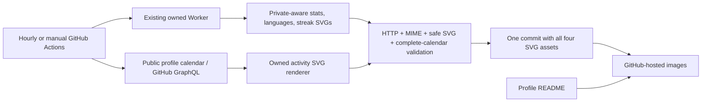

# GitHub-hosted profile card snapshots

The profile serves four checked-in SVGs from `assets/profile/`. A cold profile
view never calls Cloudflare, GitHub GraphQL, or a third-party graph deployment.
GitHub serves the last successful snapshot even if the refresh job fails.

## Architecture

The Worker remains a **refresh-only upstream**. This fix does not modify or
deploy it, create a Cloudflare account/KV namespace, or copy its private-repo
credential anywhere. `wrangler.jsonc` stays unchanged. The Worker code retains
its previous behavior; the activity renderer is also imported by the local job.

## Data visibility and privacy

- Stats, languages, and streak preserve the existing Worker's public + private
  aggregate output. It returns no repository names or raw GraphQL payloads.
- The graph requests only the profile contribution calendar. The Actions
  `GITHUB_TOKEN` is repository-scoped; it cannot enumerate Mike's other private
  repositories. The graph reflects whatever contribution counts GitHub exposes
  to that viewer, including anonymized private counts when profile settings
  permit them. It does not promise private-repository access.
- No new PAT or Actions secret is required. The job's built-in token is sent
  only to `api.github.com`, never to the Worker. Redirects are rejected.
- Only the four safe SVGs are staged/committed. No token, repository identifiers,
  raw calendar payload, or upstream error body is written to the repo or logs.
- SVGs are parsed as XML with Python's standard-library ElementTree in isolated
  mode. Processing instructions and DTDs fail during parsing. Decoded attribute
  names/values use a per-element allowlist: only numeric geometry, literal hex
  colors, known labels/classes, and the existing local language clip are allowed.
  CSS permits only the renderer's fixed font family, numeric font size/weight,
  hex fills, and known selectors. Imports, escapes, external references,
  `xml:base`, inline styles, and unknown attributes are rejected. Error and
  placeholder cards are also rejected.
- The three Worker cards display **fetched** timestamps, not claimed generation
  timestamps. Their underlying data can also be up to the Worker's cache age
  (normally 15 minutes) old. The graph displays its generation timestamp.

## Refresh and availability

`.github/workflows/profile-cards.yml` runs at minute 17 each hour and supports
manual `workflow_dispatch` on `main`. Refreshes are serialized. The job uses
Node 22 and Python 3 already present on GitHub's Ubuntu runner; no npm install
or Cloudflare tooling is needed.

The job retrieves all three upstream cards with 60-second request deadlines and
fetches the calendar with a 30-second deadline. It requires HTTP 200, SVG MIME,
expected card identity, well-formed safe SVG, and all 30 distinct calendar days
with nonnegative integer counts. All validation finishes before writing files.
Any collection/validation failure exits nonzero and leaves the local last-good
set untouched. A later filesystem or Git failure prevents publication.

A single Git commit publishes all four assets atomically. The job rebases that
commit onto current `main` before a normal (never forced) push. A conflict or
push rejection fails the job and leaves the previous published set available.
Existing blog automation is out of scope and remains unchanged. Actions-generated
pushes use the built-in token, so they do not trigger another workflow loop.

GitHub can delay scheduled runs. Scheduled workflows in inactive public repos
can also be disabled by GitHub. Check the Actions run status if the visible
timestamps stop advancing; the checked-in images will still render.

## Rollout / verification

1. Run `npm test`, `node --check scripts/refresh-profile-cards.mjs`, and
   `git diff --check`.
2. Seed all four real assets before merging. The normal refresh command is
   `npm run refresh:cards`; it reads `GITHUB_TOKEN` from the environment. Local
   operators can also read an existing authorized GitHub CLI token into process
   memory and pass it to the exported `refreshCards` function. Do not print or
   persist it. Actions uses its built-in token automatically.
3. Confirm branch README images resolve on GitHub and each committed asset is
   HTTP 200 SVG. Complete the required exact-head review/merge gates.
4. Merge the reviewed branch. No Worker deployment, namespace, signup, or new
   credential is necessary. Relative README URLs automatically resolve to the
   assets on the merged branch.
5. Dispatch **Refresh profile cards** on `main`; verify a successful run and
   its complete four-asset commit. Confirm all four images load on the public
   profile. Scheduled/manual runs execute only on `main`.

Repository Actions must be enabled and the workflow must be permitted to write
contents. Branch protection/rulesets must allow the existing Actions bot's data
updates; if they block a push, the job reports failure without bypassing the rule.

## Local tests

`npm test` exercises aggregate language/streak behavior, private-data filtering,
Worker snapshot collection, no credential forwarding, HTTP/MIME/placeholder
failures, last-good preservation, malformed/active SVG rejection, incomplete or
invalid calendars, safe complete output, the graph renderer, and checked-in
asset/README consistency. Tests use fixtures and temporary directories; they do
not call live services or modify the actual assets.

## Risks and rollback

- If the existing Worker credential expires or its service fails, snapshots
  remain visible but stop advancing. Fix that refresh upstream or migrate it
  separately; serving no longer depends on its response time.
- Public graph counts may differ from private-aware stats depending on GitHub's
  visibility policy. The graph is deliberately labeled public-profile calendar.
- Each successful hourly run normally creates one small commit because the
  fetch timestamp changes. No raw API history is committed.
- GitHub/raw-image caching can briefly show the preceding snapshot.

Disable only **Refresh profile cards** to freeze the current last-good set.
Rollback code through a normal reviewed revert while preserving the SVG assets.
If one card needs to be hidden, remove its README image; do not restore the dead
Vercel graph URL. No branch, PR, account, secret, or dataset deletion is needed.
